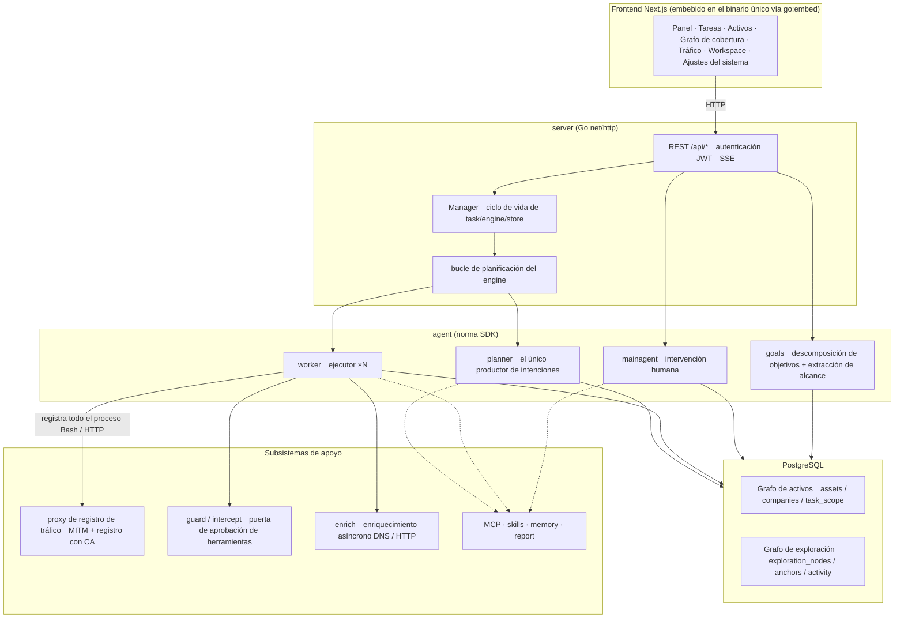
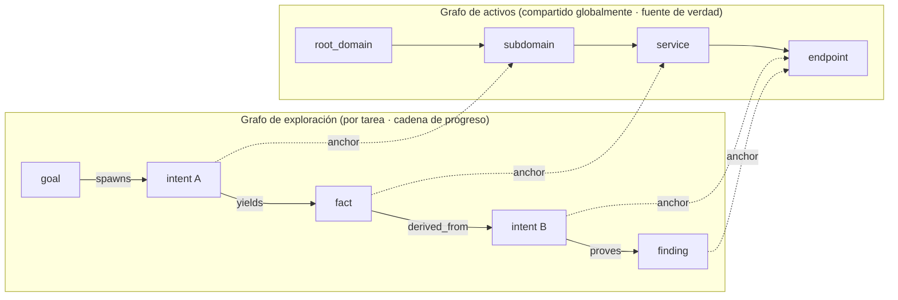
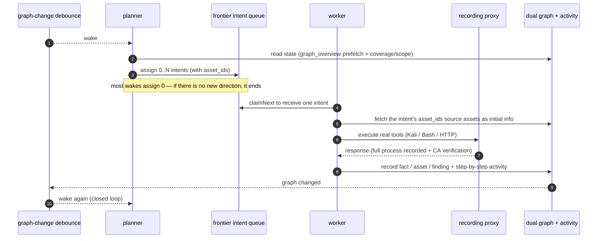
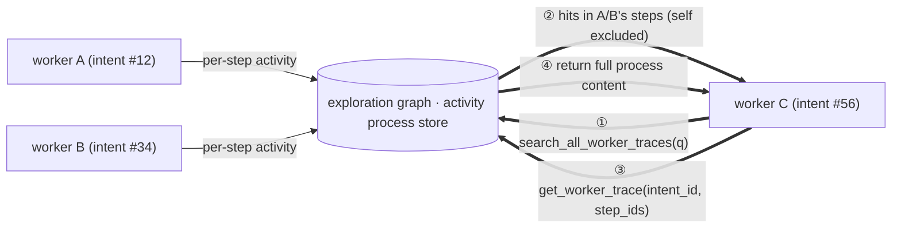
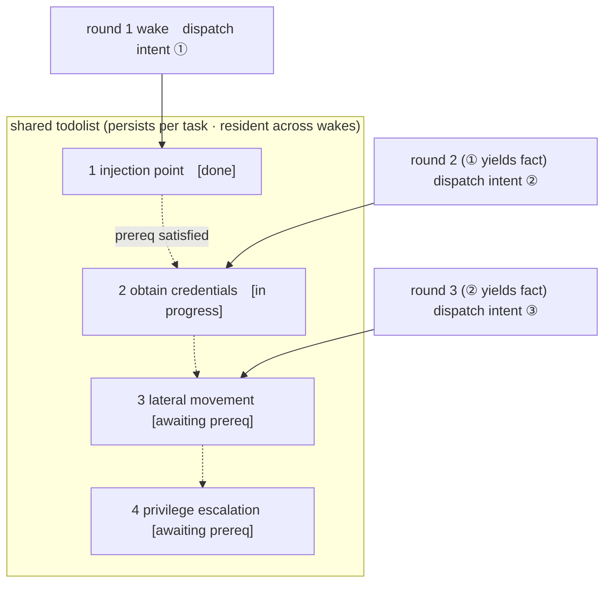

<div align="center">

# ARTEX — Edición Global

**Un sistema autónomo de pruebas de penetración impulsado por multiagentes LLM** (backend en Go + frontend en Next.js)

La interfaz y la salida generada están en inglés de forma predeterminada y **pueden cambiarse a coreano, chino, español o japonés en Ajustes (Sistema → Ajustes → Idioma de la interfaz).** Cambiar el idioma también cambia el idioma de los informes, los resúmenes y las respuestas de chat que generan los agentes.

Español · [English](README.md) · [한국어](README.ko.md) · [中文](README.zh.md) · [日本語](README.ja.md)

[](https://github.com/jiwoochris/artex-global/actions/workflows/ci.yml) [](https://github.com/jiwoochris/artex-global/actions/workflows/detections.yml) [](https://github.com/jiwoochris/artex-global/actions/workflows/web.yml) [](LICENSE)

</div>

---

> ## 🚨 Advertencia de seguridad y uso indebido — léala primero
>
> **Este repositorio se publica únicamente para su uso en entornos autorizados y solo para desarrollar capacidades de defensa y detección.**
>
> ARTEX es una herramienta ofensiva autónoma lo bastante potente como para llevar un ataque desde el reconocimiento, pasando por la intrusión, hasta la exfiltración de datos con muy poca intervención humana, de modo que el daño derivado de su uso indebido es igual de grande. En octubre de 2026, varios medios coreanos informaron de que los investigadores habían encontrado indicios de que el ARTEX original se había utilizado en filtraciones de datos personales dirigidas a entidades financieras coreanas; la investigación correspondiente sigue en curso. Esta edición global no se publica para ayudar a los atacantes. Su objetivo es ayudar a los defensores a entender cómo funcionan estos ataques autónomos de IA y a desarrollar la capacidad de detectarlos y bloquearlos.
>
> - **El uso no autorizado es un delito en sí mismo.** No ejecute ningún escaneo, sondeo ni explotación contra sistemas que no sean de su propiedad o para los que no cuente con autorización explícita por escrito. En la República de Corea, la intrusión no autorizada en una red de información y comunicaciones infringe la Ley de Redes (Network Act), y la Ley de Protección de Datos Personales (Personal Information Protection Act) también resulta aplicable cuando intervienen datos personales.
> - **No dirija el ataque a servicios en producción ni a activos de terceros.** Verifique únicamente en entornos de aprendizaje, investigación y aislados localmente que sean de su propiedad (objetivos deliberadamente vulnerables como OWASP Juice Shop o DVWA).
> - **Léalo desde el punto de vista del defensor.** Este repositorio también reúne material de defensa y detección, como firmas de detección y listas de verificación de endurecimiento, para los ataques autónomos de IA. → **[Guía de defensa y detección](docs/defense-en.md)** (también en [coreano](docs/defense-ko.md))
>
> Si no está de acuerdo con esta advertencia ni con las [restricciones de uso y el descargo de responsabilidad](#licencia-y-descargo-de-responsabilidad) que figuran más abajo, no descargue ni utilice este repositorio.

---

> **Este repositorio es una edición localizada del proyecto chino de código abierto [Autumn-27/ARTEX](https://github.com/Autumn-27/ARTEX) (AGPL-3.0 · el repositorio original está actualmente inaccesible, comprobado en 2026-10), adaptada para que usuarios y equipos de todo el mundo puedan adoptarlo tal cual.** Para preservar el rendimiento de decisión de los agentes, los prompts de razonamiento interno se mantienen en el idioma original, y solo la salida orientada al usuario (hallazgos, resúmenes, informes y respuestas de chat) se fuerza al idioma seleccionado (inglés de forma predeterminada). Consulte ["Por qué una edición global"](#por-qué-una-edición-global) más abajo para conocer el razonamiento.

ARTEX es un sistema en el que varios agentes impulsados por LLM ejecutan de forma autónoma una prueba de penetración: **descomponen los objetivos por su cuenta, ejecutan herramientas reales y van acumulando en un grafo los activos y las vulnerabilidades que descubren** a medida que avanzan. Un único binario de Go incorpora el frontend de Next.js embebido, y todos los datos se almacenan en PostgreSQL.

> **Nota sobre el idioma de esta edición.** Este fork hace que el producto se pueda usar en cinco idiomas — **inglés (predeterminado), coreano, chino, español y japonés** — seleccionables en Ajustes. La salida orientada al usuario se fuerza al idioma seleccionado, mientras que los prompts de razonamiento interno de los agentes se mantienen en el idioma original para preservar el rendimiento medido en los benchmarks. Consulte [Configuración](#configuración) para saber cómo se impone el idioma de salida mediante una pequeña directiva fijada en el código.

---

## ⚠️ Léalo primero — uso autorizado y aviso legal

ARTEX solo puede usarse **contra objetivos de su propiedad o para los que tenga autorización explícita por escrito.** Cualquier escaneo, sondeo o explotación que exceda el alcance autorizado puede ser ilegal en sí mismo.

- En la República de Corea, acceder sin autorización a la red de información y comunicaciones de un tercero, o perturbarla, infringe la **Ley de Promoción del Uso de Redes de Información y Comunicaciones y de Protección de la Información** (정보통신망법).
- Los datos personales recopilados o expuestos durante una prueba de penetración están sujetos a la **Ley de Protección de Datos Personales** de Corea (개인정보보호법). Incluso con autorización, maneje con cuidado el acceso, la retención y la eliminación de datos personales.
- Esté donde esté, cumpla las leyes de su propia jurisdicción sobre seguridad de redes, protección de datos y delitos informáticos.
- Utilícelo para **aprendizaje, investigación y verificación en entornos aislados localmente.** Antes de dirigirse a cualquier sistema externo en producción, obtenga autorización por escrito y un alcance y una ventana de tiempo acordados.

Los términos completos de la licencia, las restricciones de uso y el descargo de responsabilidad figuran en la sección [Licencia y descargo de responsabilidad](#licencia-y-descargo-de-responsabilidad) más abajo. El uso de esta herramienta constituye su aceptación de dichos términos.

---

## Por qué una edición global

El ARTEX original tiene sus prompts, su interfaz y su documentación enteramente en chino, lo que resultaba engorroso para cualquiera que no lea chino a la hora de leer los resultados y compartirlos con un equipo. Esta edición busca:

- **Localizar la salida** — los hallazgos, los resúmenes de hechos, los informes finales y las respuestas de chat que los agentes muestran a una persona se fuerzan al idioma seleccionado (inglés de forma predeterminada; coreano, chino, español y japonés seleccionables). Los comandos, los payloads, el código, las URL y los registros en bruto se necesitan para el análisis y se dejan en su forma original.
- **Preservar el rendimiento** — los prompts de razonamiento interno (el cuerpo de instrucciones de comportamiento) que guían el juicio de los agentes **no** se traducen. El comportamiento medido en los benchmarks en el idioma original se mantiene intacto, y solo cambia el idioma de salida, lo que evita la deriva de calidad que introduce la traducción.
- **Enunciar los límites legales** — la advertencia de "solo dentro del alcance autorizado" se expresa con claridad, junto con los avisos específicos de Corea sobre derecho de redes y privacidad (los mantenedores residen en Corea); también se aplica la ley del lugar donde usted opere.
- **Dar soporte a diversas infraestructuras de LLM** — el proveedor de LLM puede cambiarse de un modelo de frontera a cualquier endpoint compatible con OpenAI (modelos locales o abiertos). Consulte [Configuración](#configuración).

> Los límites y la política de diseño de esta edición multilingüe se documentan con más detalle en las notas de trabajo del repositorio. Para facilitar la comparación (diff) con el repositorio original, el documento chino original se conserva como [`README.zh.md`](README.zh.md).

---

## Capturas de pantalla

Las tres pantallas siguientes muestran la interfaz predeterminada en inglés (conmutable a coreano, chino, español y japonés en Ajustes). Los datos provienen de un entorno de pruebas local y aislado: todos los objetivos son el ficticio `acme.com` y rangos de direcciones privadas.

<p align="center">
  <br>
  <sub><b>Panel</b> — tareas activas, hallazgos confirmados, nodos de activos, gasto de tokens de LLM y el feed de actividad en una sola pantalla.</sub>
</p>

<p align="center">
  <br>
  <sub><b>Hallazgos</b> — resultados agregados por severidad, estado, activo y tarea propietaria, exportables a CSV.</sub><br>
  <sub>Los <b>títulos</b> de los hallazgos los genera el modelo, por lo que pueden aparecer términos técnicos en inglés, reflejando la aplicación objetivo ([Selección de modelo e idioma de salida](#selección-de-modelo-e-idioma-de-salida)). La descripción bajo cada título y el resto de la interfaz están en inglés (el predeterminado; conmutable en Ajustes).</sub>
</p>

<p align="center">
  <br>
  <sub><b>Chat</b> — una persona interviene en la ejecución autónoma para inyectar pistas mientras el agente resume la cadena de ataque en inglés.</sub>
</p>

Las pantallas originales (interfaz en chino) están disponibles en [`README.zh.md`](README.zh.md#截图预览) (interfaz en chino).

---

## Inicio rápido (Docker Compose)

> **Requisitos previos:** Docker y Docker Compose. La base de datos es **PostgreSQL**, levantada por compose. La exploración requiere un **LLM** (`ANTHROPIC_API_KEY` u `OPENAI_API_KEY`; también se puede configurar en la interfaz).

> **Imagen:** el servicio `artex` de `docker-compose.yml` descarga `ghcr.io/jiwoochris/artex-global`, la imagen de la edición global que este repositorio publica en GitHub Container Registry con cada etiqueta de versión (`v*`). La etiqueta predeterminada es `latest` (la versión más reciente); fije `ARTEX_TAG` en `.env` para anclar una versión concreta. La imagen original `autumn27/artex` se ha retirado de Docker Hub y ya no se utiliza.

```bash
git clone https://github.com/jiwoochris/artex-global.git
cd artex-global
cp .env.example .env          # set POSTGRES_PASSWORD; ANTHROPIC_API_KEY is optional
docker compose up -d          # brings up the artex image + postgres together
# → open http://localhost:8787 (on first visit, set the admin password at /setup)
#   /setup asks for the setup token printed in the startup log: docker compose logs artex | grep -F '[auth]'
```

La imagen incluye herramientas habituales (ripgrep, curl, vim, npm, nmap y más), y cuando se levanta con compose, `./skills` y `./data` se montan (bind-mount) en el host y sobreviven a la recreación del contenedor.

### Otros métodos de instalación

El proyecto original ofrece varios métodos: un script de instalación (`./install.sh`), binarios precompilados (Releases) y una compilación de binario único desde el código fuente. Los comandos y el procedimiento completo están reunidos en la sección "安装" (Instalación) de [`README.zh.md`](README.zh.md#安装) (en chino); lo esencial se reproduce a continuación.

- **Script de instalación:** ejecutar `./install.sh` detecta/instala Docker y luego le permite elegir "① todo en Docker" o "② compilar y ejecutar localmente". "① todo en Docker" descarga y arranca la misma imagen que el inicio rápido de arriba (`ghcr.io/jiwoochris/artex-global`), mientras que "② compilar y ejecutar localmente" la construye usted mismo de la misma manera que la **compilación de binario único desde el código fuente** descrita abajo.
- **Compilación de binario único desde el código fuente:**

  ```bash
  cd web && npm ci && npm run build:static && cd ..   # 1) static frontend build
  rm -rf server/webui/dist && mkdir -p server/webui/dist && cp -a web/out/. server/webui/dist/   # 2) sync into the embed directory (avoids nesting on rebuild)
  CGO_ENABLED=0 go build -tags embedui -o artex ./cmd/artex   # 3) compile with the frontend embedded
  ./start.sh                                          # → http://localhost:8787
  ```

> El `npm ci` del paso 1) instala las devDependencies que la compilación necesita (por ejemplo, `@tailwindcss/postcss`). Si su shell tiene `NODE_ENV=production` establecido, `npm ci` omite las devDependencies y la compilación falla con `Error: Cannot find module '@tailwindcss/postcss'`; en ese caso, instálelas con `npm ci --include=dev`.

> Arranque con `start.sh` (`start.bat` en Windows) en lugar de ejecutar `./artex` directamente. Ese script es un supervisor que reinicia el programa según su código de salida, y también gestiona la "actualización con un clic" de la interfaz.

---

## Configuración

**Base de datos** (`config.json`, o sobrescriba con la variable de entorno `ARTEX_PG_DSN`):

```json
{
  "database": {
    "host": "127.0.0.1", "port": 5432,
    "user": "artex", "password": "yourpass",
    "dbname": "artex", "sslmode": "disable"
  }
}
```

**LLM:** `export ANTHROPIC_API_KEY=sk-...` (o `OPENAI_API_KEY`), o introdúzcala en la página "LLM settings" de la interfaz. Variables de entorno opcionales: `ARTEX_LLM_PROVIDER` / `ARTEX_LLM_MODEL` / `ARTEX_LLM_BASE_URL` / `ARTEX_LLM_PROXY`. Para usar un modelo local o abierto, apunte `ARTEX_LLM_BASE_URL` a un endpoint compatible con OpenAI.

**Idioma de salida:** esta edición fuerza la salida orientada al usuario al idioma seleccionado (inglés de forma predeterminada) mediante una pequeña directiva fijada en el código que se añade al system prompt de cada rol (no traduce el cuerpo de razonamiento). Cambie de idioma en Ajustes, o adapte esa directiva en `agent/prompt.go` (`langDirective`).

**Concurrencia:** el número de agentes worker generados por tarea es ajustable en "System settings" (3 por defecto).

**Flags habituales:** `./start.sh -addr :8787 -proxy :8788` — `-addr` es el frontend y la API, `-proxy` es el puerto del proxy de registro de tráfico. `-addr` por defecto es `127.0.0.1:8787` (solo conexiones locales); pase una dirección de enlace explícita como `:8787` para servir a otras máquinas (consulte "Protección en el primer arranque" más abajo).

### Selección de modelo e idioma de salida

La imposición del idioma de salida está **guiada por una directiva del prompt (`langDirective()` en `agent/prompt.go`), no por un límite fijado en el código.** Por eso, la consistencia con la que la salida se mantiene en el idioma seleccionado depende de la capacidad del modelo, del rol y del contexto. Las cifras de validación de más abajo se midieron con salida en coreano cuando el coreano era el predeterminado; la misma tendencia se mantiene para los demás idiomas.

- **Use un modelo de frontera capaz.** En una ejecución de validación breve que aplicó únicamente la directiva de producción contra un entorno de pruebas local y aislado, el modelo predeterminado `claude-opus-4-8` mantuvo la salida orientada al usuario en coreano en los cuatro roles — planner, worker, reporter y una solicitud de planificación en un entorno de pruebas autorizado — sin rechazos. `gpt-4o` también se mantuvo en coreano en los mismos escenarios. En cambio, un modelo más barato y pequeño (por ejemplo `gpt-4o-mini`) dejó que el informe volviera al idioma original. La calidad del idioma de salida sigue directamente la capacidad del modelo, así que use un modelo capaz allí donde una persona vaya a leer el informe.
- **Persiste cierta deriva que depende del rol y del contexto.** La divergencia aparece más en el rol y el formato de salida que en el idioma en sí. En particular, las salidas cortas, como el resumen final de una sola frase del worker, pueden exponer textualmente la cadena de razonamiento en inglés del modelo, y los campos estructurados de `report_finding` pueden inclinarse hacia el inglés, reflejando la aplicación objetivo y sus términos técnicos. En una ejecución anterior, el resumen de situación del planner de `gpt-4o` también volvió al idioma original en algunos turnos. Indicar explícitamente "escribe en el idioma seleccionado" en la instrucción de la tarea aumenta la fidelidad.
- **Dé a los modelos de razonamiento un `max_tokens` generoso.** Un modelo de razonamiento que usa un canal de pensamiento separado puede gastar un presupuesto pequeño de tokens de respuesta enteramente en el razonamiento interno y dejar vacía la respuesta final orientada al usuario. Aquí lo que desaparece es la respuesta en sí, no el idioma, así que establezca el `max_tokens` de ese perfil de LLM lo bastante alto.

> **Trampa del límite de tokens en la ruta compatible con OpenAI.** Los modelos de la familia OpenAI como `gpt-4o` limitan los tokens de respuesta a 16 384. Las solicitudes compatibles con OpenAI, sin embargo, llevan un límite de salida predeterminado mayor (32 768), de modo que dejarlo sin cambios hace que cada llamada falle con `400 (max_tokens is too large)`. En ese caso, **establezca el `max_tokens` de ese perfil en 16 384 o menos en la página de LLM settings.** Los modelos de la familia Anthropic (incluido el predeterminado `claude-opus-4-8`) permiten 32 768 y no caen en esta trampa.

### Protección en el primer arranque (token de configuración y dirección de enlace)

Hay una única cuenta de administrador (`ARTEX`) cuya contraseña se crea en la primera visita en `/setup`. Para que quien llegue primero a una instancia aún no inicializada no pueda apropiársela, se aplican las siguientes protecciones.

- **Token de configuración.** Cuando el servidor arranca sin contraseña, imprime una línea `[auth] … Setup token: …` en la consola (el idioma predeterminado es el inglés, por lo que el registro también está en inglés; `docker compose logs artex` bajo Docker). `/setup` y `POST /api/auth/init` (campo `setup_token`) solo crean la contraseña cuando ese valor coincide, y los intentos erróneos tienen límite de frecuencia. Para despliegues desatendidos, fíjelo con `ARTEX_SETUP_TOKEN`, o establezca la contraseña directamente con `ARTEX_ADMIN_PASSWORD` (8 o más caracteres).
- **Se enlaza a 127.0.0.1 por defecto.** Tanto el valor predeterminado de `-addr` de `artex` como la publicación de puertos en `docker-compose.yml` abren únicamente la interfaz de loopback. Para alcanzarla desde otras máquinas, use `-addr :8787` o `ARTEX_BIND=0.0.0.0` en `.env`, pero termine primero la configuración inicial y prefiera la disposición con proxy inverso de más abajo. Arrancar sin contraseña en una dirección que no sea loopback registra una advertencia.
- **Cambiar la contraseña finaliza todas las sesiones.** La clave de firma de los tokens está ligada al hash de la contraseña, de modo que los tokens emitidos antes de un cambio (desde la interfaz, `reset-password.sh` o una edición directa de la BD) dejan de funcionar en cuestión de segundos. Al recuperarse de una cuenta comprometida, revise también las herramientas personalizadas, MCP, el LLM y los ajustes de notificación después de cambiar la contraseña.
- **CORS.** `/api` solo responde a llamadas de navegador de origen cruzado procedentes de orígenes listados en `ARTEX_CORS_ORIGINS` (separados por comas). La interfaz embebida es del mismo origen, así que esto normalmente está vacío; el valor predeterminado solo permite `next dev` desde `dev.sh` (`http://localhost:5173`).

### Despliegue con proxy inverso (HTTPS / exponer solo el 443)

El frontend y la API/SSE los sirve el mismo puerto de backend (por defecto `:8787`), y el flujo de actividad en vivo se conecta **al mismo origen** de forma predeterminada. Así que no hace falta establecer `NEXT_PUBLIC_SSE_BASE` por separado: exponga solo el 443 a la red pública y mantenga el 8787 interno.

SSE mantiene una conexión de larga duración y sigue enviando eventos, por lo que **debe desactivar el almacenamiento en búfer (buffering)** en el proxy inverso. Si no lo hace, el navegador se conecta pero no recibe ningún evento (el flujo de actividad parece quedarse cargando). Hay un ejemplo de configuración de Nginx en [`README.zh.md`](README.zh.md#反向代理部署https--只开放-443).

---

## Arquitectura del sistema

ARTEX es un **sistema autónomo de penetración impulsado por multiagentes LLM.** Usa un único backend en Go (con el frontend de Next.js embebido) sobre PostgreSQL, y las capacidades de los agentes las provee el SDK [`norma`](https://github.com/Autumn-27/norma) (actualmente inaccesible, comprobado en 2026-10). En su núcleo está una **estructura de grafo doble** y los dos mecanismos de autonomía que la rodean: el intercambio de información a nivel de proceso entre workers y la todolist compartida multironda del planner.

### Capas generales



- **Frontend** — la compilación estática de Next.js se embebe en el binario único con `go:embed`. Visualiza tareas, activos, cadenas de exploración y el grafo de cobertura, y ofrece el chat con intervención humana.
- **server** — gestiona el enrutamiento de `net/http`, la autenticación JWT y SSE; el `Manager` es dueño del ciclo de vida de las tareas, los engines y el store de la BD.
- **engine** — por cada tarea, ejecuta un `plannerLoop` y N goroutines worker, encargándose de la asignación de intenciones, los timeouts, la pausa y el drenaje (drain).
- **agent** — se divide en goals / planner / worker / mainagent; el `ToolSet` expone el grafo doble como herramientas del LLM.
- **db** — almacena el grafo doble en PostgreSQL (pgx); el esquema embebido vía `go:embed` crea las tablas de forma idempotente en cada arranque.
- **apoyo** — el proxy MITM de registro, la puerta de aprobación, el enriquecimiento asíncrono y MCP / skills / memory / report.

### El grafo doble: grafo de exploración + grafo de activos

El sistema separa "qué es el objetivo" de "hasta dónde se ha probado" en dos grafos que son independientes pero están enlazados por anclas (anchors).

- **Grafo de activos (compartido globalmente)** — el almacén de activos que sirve de fuente de verdad, compartido entre tareas. Los nodos son `root_domain / subdomain / ip / service / app / endpoint` y pertenecen a una empresa. Las relaciones padre-hijo (domain → subdomain → service → endpoint) y las claves de deduplicación las calcula todas el programa; los agentes solo envían la información en bruto.
- **Grafo de exploración (independiente por tarea)** — el "pensamiento y el progreso" de una sola tarea. Los nodos son `goal / intent / fact / finding / hint`, conectados por aristas como `spawns / derived_from / yields / proves` para formar cadenas de linaje.
- **Los dos grafos se enlazan mediante anclas** — `exploration_anchors(node_id, asset_id)` fija las intenciones, los hechos y los hallazgos a activos concretos. Esto permite consultar, desde el lado de la exploración, a qué activo atacaba una dirección y, a la inversa, qué intención probó un activo dado en esta tarea y qué hechos produjo — en ambos sentidos.



> Reparto de roles: el **planner** lee el estado del grafo de exploración y juzga los objetivos, emitiendo **intenciones** a la frontera solo cuando hay una dirección nueva aún no cubierta. Un **worker** toma una **sola intención**, la ejecuta con herramientas reales, escribe los nuevos activos/hechos/hallazgos en ambos grafos y luego se detiene. El grafo de activos es verdad compartida; el grafo de exploración es la cadena de progreso por tarea.

### El engine y el ciclo de vida de la intención (un bucle de exploración cerrado)

El engine es un bucle cerrado **orientado a eventos**. Cuando el grafo cambia despierta al planner; cuando el planner emite una intención un worker la reclama, la ejecuta y escribe los resultados; esa escritura dispara a su vez la siguiente ronda. Este ciclo continúa hasta que se demuestra un objetivo (`prove_goal`).



### Intercambio de información a nivel de proceso entre workers

En la exploración profunda, las observaciones valiosas (un error concreto, un fragmento de respuesta, un parámetro oculto) surgen a menudo durante el **proceso de ejecución** de un worker sin quedar registradas como un hecho formal. Para evitar el trabajo duplicado y dejar que workers posteriores se apoyen en observaciones anteriores, los workers pueden **buscar en los procesos de otros workers.**

- `search_all_worker_traces(q)` — busca por palabra clave en los procesos de ejecución de otros workers de la misma tarea (los pasos de la propia intención del worker se excluyen automáticamente). Las coincidencias llevan un `intent_id`.
- `list_worker_traces` / `get_worker_trace(intent_id, step_ids=[…])` — primero vea qué workers se ejecutaron, luego extraiga el contenido completo de pasos concretos de un worker dado para intercambiar detalles.

De esta manera, incluso cuando todavía no hay un hecho correspondiente en el grafo de exploración, un worker posterior reutiliza observaciones del proceso de otro. La información fluye entre workers al nivel del "proceso de ejecución" mientras se mantienen intactos los límites (cada worker sigue realizando solo su única intención asignada).



### La todolist compartida multironda del planner → una cadena de ataque estable

Una cadena de ataque real suele ser una secuencia ordenada de pasos mutuamente dependientes (p. ej., encontrar un punto de inyección → obtener credenciales → movimiento lateral → escalada de privilegios), y despacharlos todos en paralelo de una vez los enredaría. Por eso el planner mantiene una **todolist de planificación que persiste por tarea y se comparte entre despertares.**

- El planner está orientado a eventos, así que despierta cada vez que cambia el grafo, pero **cada despertar es una sesión nueva.** La todolist compartida registra la cadena de ataque serial **una sola vez** y luego, a lo largo de las rondas siguientes, asigna intenciones **un paso cada vez en orden de dependencia** (no despliega toda la cadena por adelantado en una sola ronda).
- En cada ronda, asigna una intención solo al siguiente paso cuyo prerrequisito esté hecho y cuyo hecho dependido ya exista, actualizando la lista a medida que avanza (marcando como completos los pasos satisfechos por hechos).



Esto permite que la cadena de ataque progrese de forma fiable incluso en un entorno de "sesión sin estado + orientada a eventos" — sin duplicación y sin salirse de orden. Este es el núcleo de cómo ARTEX completa de forma autónoma cadenas de ataque de varios pasos.

---

## Material de defensa y detección

Este repositorio busca ayudar al **lado defensor** a entender cómo funcionan los ataques autónomos de IA y a desarrollar la capacidad de detectarlos y bloquearlos. Toma el comportamiento de ARTEX descrito en la arquitectura anterior y lo da la vuelta hacia una **vista de defensor**, exponiendo qué observar y dónde reforzar.

- **[Guía de defensa y detección (docs/defense-en.md)](docs/defense-en.md)** (también en [coreano](docs/defense-ko.md))
  - En qué se diferencian los ataques autónomos de IA de los escáneres tradicionales, por qué son difíciles de detectar y cómo detectarlos de todos modos
  - Las huellas que un defensor puede observar (IoC y firmas de comportamiento) — separadas en la vista del objetivo y la vista forense
  - Los puntos de entrada a los que apuntan los atacantes y el endurecimiento correspondiente (autenticación auxiliar, IDOR, relleno de credenciales, sesiones y secretos)
  - Reglas de detección de WAF/SIEM/registros de autenticación (pseudo-reglas), una lista de verificación de endurecimiento y un resumen de respuesta a incidentes
  - Canales oficiales coreanos para indicadores de compromiso y avisos (KISA, FSI, PIPC) y las obligaciones de notificación bajo la ley coreana
- **[Reglas de detección desplegables (detections/)](detections/)** — las detecciones de huellas de la guía entregadas como reglas listas para usar: la capa de host/log/SIEM como reglas [Sigma](https://sigmahq.io) (atómicas + correlación; use `sigma convert` para Splunk, Elasticsearch y otros), y la capa de red como reglas [Suricata](https://suricata.io) dirigidas a los User-Agent del sondeador de enrich y del WebFetch del SDK norma.
  - **[Capa de cobertura ATT&CK (detections/attack/)](detections/attack/)**: una capa de [MITRE ATT&CK Navigator](https://mitre-attack.github.io/attack-navigator/) (JSON) que mapea las reglas anteriores a las técnicas que etiquetan, para que vea de un vistazo qué comportamiento de ataque captura cada regla. Cada técnica proviene únicamente de las etiquetas `attack.*` de una regla, sin nada añadido por conjetura.
  - **[Lista de indicadores legible por máquina (detections/indicators/)](detections/indicators/)**: las huellas únicas que el propio ARTEX emite, reunidas en un único CSV (`artex_indicators.csv`) y entregadas también como un evento MISP listo para importar (`artex_indicators.misp.json`), para que pueda cargarlas directamente en una tabla de consulta (lookup) de SIEM o en una plataforma de inteligencia de amenazas (MISP, o cualquiera que ingiera el formato MISP) como indicadores de compromiso (IoC). Cada valor es una cadena verificada en el código fuente del repositorio, y cada fila lleva su archivo de origen y su regla de detección.
  - **[Script de triaje de host (detections/triage/)](detections/triage/)**: un script de solo lectura, [`artex_host_triage.py`](detections/triage/artex_host_triage.py), para el respondedor que está ante el shell de un único host sospechoso sin SIEM ni sensor de red. Comprueba las mismas huellas que las reglas anteriores, más — en la propia máquina — los tres indicadores de host/BD que el CSV de indicadores lleva deliberadamente sin una regla Sigma porque no son observables por log ni por red (el puerto de escucha del servidor, el endpoint del proxy de registro y el esquema de exploración de PostgreSQL). Se ejecuta solo con la biblioteca estándar, sin nada que instalar, y cada hallazgo es una pista de triaje que lleva la misma advertencia que su fila de indicador, nunca una atribución por sí solo.
  - Las reglas, la capa, los indicadores anteriores y la autoprueba del script de triaje de host se vuelven a ejecutar y verificar mediante los tests del repositorio ([detections/tests/](detections/tests/)): una regla de detección que no se puede ejecutar es solo una afirmación.

> Este material se amplía continuamente. Sugiera reglas de detección o elementos de endurecimiento adicionales como issues, y cuando envíe una regla directamente, siga el contrato de [la sección "Contributing detection rules and detection tests" de la guía de contribución](CONTRIBUTING.en.md#contributing-detection-rules-and-detection-tests) (fundamente cada indicador en un hecho observable, enuncie los límites, pase la validación estática e incluya un test reproducible).

---

## Desarrollo

Desarrollo y pruebas locales:

```bash
./dev.sh    # backend (:8787) + traffic proxy (:8788) + frontend next dev (:5173) → http://localhost:5173
```

- Backend: `go run ./cmd/artex` (sin `-tags embedui` el frontend no se embebe)
- Frontend: `cd web && npm run dev` (hace de proxy de `/api` al backend, con recarga en caliente)
- Pruebas: `go test ./...`
- Vista previa simulada (sin backend): `cd web && NEXT_PUBLIC_MOCK=1 npm run dev`

Para otros temas de desarrollo (como la reverificación manual de vulnerabilidades), consulte la sección "开发" (Desarrollo) de [`README.zh.md`](README.zh.md#开发).

Los cambios que esta edición global añade sobre el ARTEX original se registran en el [registro de cambios (CHANGELOG.en.md)](CHANGELOG.en.md).

---

## Licencia y descargo de responsabilidad

### Licencia de código abierto

Este proyecto se distribuye bajo la **GNU Affero General Public License v3.0 (AGPL-3.0)**. Los términos completos están en el archivo [LICENSE](LICENSE) en la raíz del repositorio.

Cualquiera puede usarlo, modificarlo y distribuirlo libremente, pero **las obras derivadas también deben publicarse bajo AGPL-3.0.** En particular, si modifica este proyecto y **lo proporciona a usuarios a través de una red (por ejemplo, como servicio en línea), debe poner a disposición de esos usuarios el código fuente completo correspondiente.** Esta edición global también mantiene la AGPL-3.0.

> ⚠️ **Importante:** una licencia de código abierto por sí sola no restringe cómo puede usarse el software. Las "Restricciones de uso" y el "Descargo de responsabilidad" de más abajo son un pacto adicional y un aviso serio que el autor original exige de los usuarios — por favor, obsérvelos.

### Restricciones de uso

- Use esta herramienta para **leer y estudiar el código fuente**, y para **verificar sus principios técnicos en un entorno aislado localmente.**
- A menos que el objetivo sea de su propiedad o cuente con **autorización explícita por escrito**, no escanee, sondee, explote ni ataque ningún sitio web, servicio en línea ni sistema conectado.
- Usarla para intrusión ilegal, robo de datos, denegación de servicio (DoS) o cualquier otra actividad destructiva o delictiva está estrictamente prohibido.
- Debe cumplir todas las leyes sobre seguridad de redes, protección de datos y delitos informáticos de su país y región (en Corea, la 정보통신망법, la 개인정보보호법 y otras).

### Descargo de responsabilidad

Este proyecto se proporciona "TAL CUAL" (AS IS), sin garantía alguna, expresa o implícita. El autor original y los contribuidores no se hacen responsables de ningún daño directo o indirecto, pérdida de datos, daño al sistema ni disputa legal que surja del uso de esta herramienta (con independencia de si se usó de forma apropiada o no). **Descargar, instalar o usar este proyecto se considera que constituye haber leído, entendido y aceptado todas las condiciones anteriores.**

**Toda la responsabilidad legal y las consecuencias recaen sobre el usuario.**

---

## Proyecto original (upstream)

- Repositorio original: [Autumn-27/ARTEX](https://github.com/Autumn-27/ARTEX) (actualmente inaccesible, comprobado en 2026-10)
- README original (chino): [README.zh.md](README.zh.md)
- Demo en línea original (interfaz en chino): [https://artex-demo.vercel.app/](https://artex-demo.vercel.app/) (actualmente inaccesible, comprobado en 2026-10)
- SDK de agentes: [Autumn-27/norma](https://github.com/Autumn-27/norma) (actualmente inaccesible, comprobado en 2026-10)

## OSINT and source packs

Redex now ships an OSINT workbench (collectors, face search, 16 keyed providers,
GraphML export), eight SHA256-pinned source packs on GitHub Releases, schedules and
an encrypted credential vault. See the English
[README OSINT section](README.md#osint-and-identity-pivoting) and
[`docs/agent-integration.md`](docs/agent-integration.md) for details.
