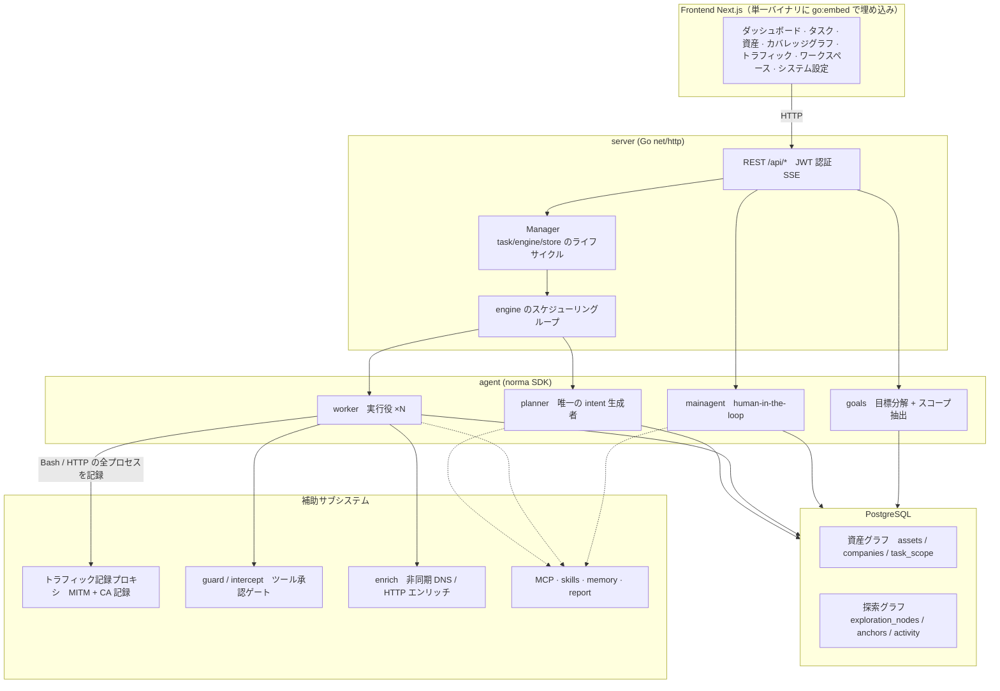
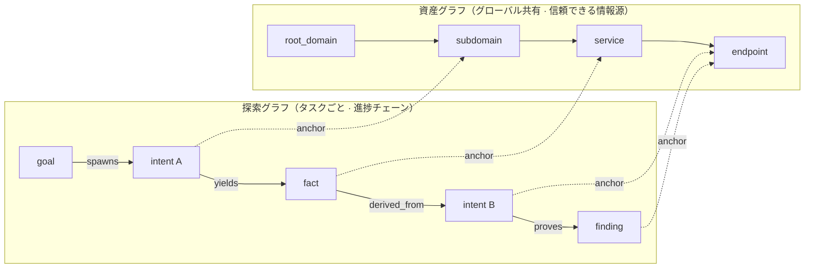
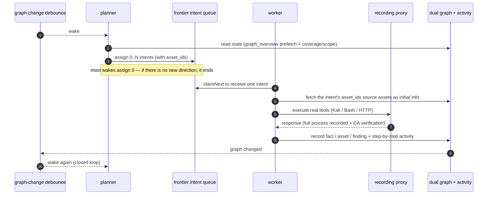
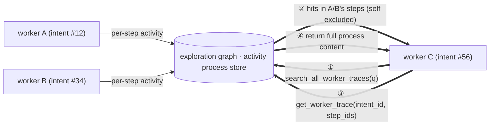
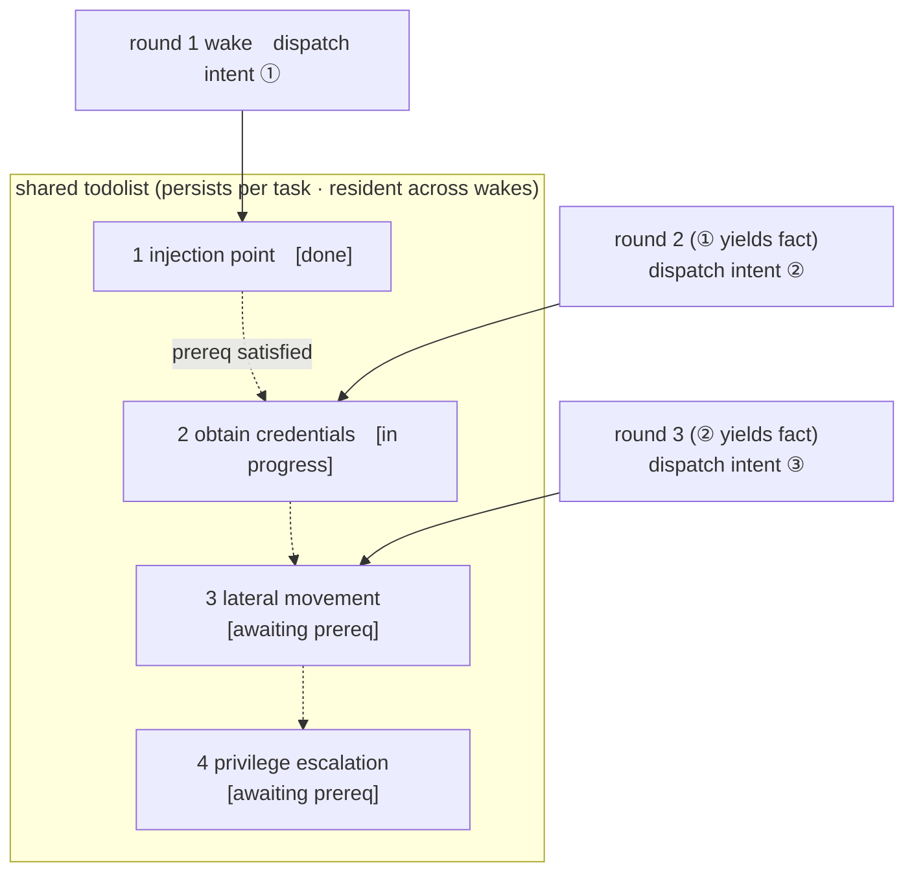

<div align="center">

# ARTEX — グローバル版

**LLM マルチエージェントが駆動する自律型ペネトレーションテストシステム**（Go バックエンド + Next.js フロントエンド）

UI と生成される出力はデフォルトで英語になっており、**設定（システム → 設定 → 表示言語）で韓国語・中国語・スペイン語・日本語に切り替えられます。** 言語を変えると、エージェントが生成するレポート・要約・チャット応答の言語も一緒に変わります。

日本語 · [English](README.md) · [한국어](README.ko.md) · [中文](README.zh.md) · [Español](README.es.md)

[](https://github.com/jiwoochris/artex-global/actions/workflows/ci.yml) [](https://github.com/jiwoochris/artex-global/actions/workflows/detections.yml) [](https://github.com/jiwoochris/artex-global/actions/workflows/web.yml) [](LICENSE)

</div>

---

> ## 🚨 セキュリティと悪用に関する警告 — 最初にお読みください
>
> **このリポジトリは、許可された環境の中で、かつ防御・検知の能力を育てる目的に限って利用するために公開しています。**
>
> ARTEX は、偵察から侵入、データの持ち出しまでを人の関与をほとんど介さずに遂行できるほど強力な自律型攻撃ツールであり、それだけに悪用による被害も大きくなります。2026 年 10 月、韓国の複数の報道機関は、調査機関が韓国の金融機関を狙った個人情報の流出事案において上流版 ARTEX が使われた痕跡を見つけたと報じました。関連する調査は現在も進行中です。このグローバル版は攻撃者を助けるために公開するものではありません。その目的は、こうした自律型 AI 攻撃がどのように動くのかを防御側が理解し、それを検知・遮断する能力を育てる手助けをすることにあります。
>
> - **無許可の利用はそれ自体が犯罪です。** 自分が所有していないシステム、または明示的な書面による許可を得ていないシステムに対して、いかなるスキャン・探査・エクスプロイトも実行しないでください。大韓民国では、情報通信網への無許可の侵入は情報通信網法（Network Act）に違反し、個人情報が関わる場合には個人情報保護法（Personal Information Protection Act）も適用されます。
> - **稼働中のサービスや第三者の資産を標的にしないでください。** 自分が所有する、学習・研究・ローカルに隔離された環境でのみ検証してください（OWASP Juice Shop や DVWA のように、意図的に脆弱に作られた標的）。
> - **防御側の視点で読んでください。** このリポジトリには、自律型 AI 攻撃に対する検知シグネチャやハードニングのチェックリストといった防御・検知の資料もまとめてあります。→ **[防御・検知ガイド](docs/defense-en.md)**（[韓国語版](docs/defense-ko.md)もあります）
>
> この警告、および下記の[利用制限と免責事項](#ライセンスと免責事項)に同意できない場合は、このリポジトリをダウンロードしたり利用したりしないでください。

---

> **このリポジトリは、中国発のオープンソースプロジェクト [Autumn-27/ARTEX](https://github.com/Autumn-27/ARTEX)（AGPL-3.0 · 上流リポジトリは現在アクセス不可、2026-10 確認）を、世界中のユーザーやチームがそのまま採用できるようにローカライズした版です。** エージェントの意思決定性能を保つため、内部の推論プロンプトは原語のまま維持し、ユーザー向けの出力（検出結果・要約・レポート・チャット応答）だけを選択した言語（デフォルトは英語）に強制します。その理由は下記の[「なぜグローバル版なのか」](#なぜグローバル版なのか)で説明します。

ARTEX は、LLM が駆動する複数のエージェントが自律的にペネトレーションテストを進めるシステムです。エージェントは **自分で目標を分解し、実際のツールを実行し、発見した資産と脆弱性をグラフに積み上げていきます。** Go の単一バイナリに Next.js フロントエンドが埋め込まれており、すべてのデータは PostgreSQL に保存されます。

> **この版の言語についての注記。** このフォークは、製品を 5 つの言語 — **英語（デフォルト）、韓国語、中国語、スペイン語、日本語** — で利用できるようにし、設定で選べるようにしました。ユーザー向けの出力は選択した言語に強制される一方、エージェントの内部推論プロンプトはベンチマークされた性能を保つために原語のまま維持されます。出力言語が小さなコード固定のディレクティブによってどのように強制されるかは[設定](#設定)を参照してください。

---

## ⚠️ 最初にお読みください — 許可された利用と法的告知

ARTEX は、**自分が所有する標的、または明示的な書面による許可を得ている標的に対してのみ** 利用できます。許可された範囲を超えるスキャン・探査・エクスプロイトは、それ自体が違法となる場合があります。

- 大韓民国では、第三者の情報通信網に無許可で侵入したり、それを妨害したりする行為は **「情報通信網利用促進及び情報保護等に関する法律」**（정보통신망법）に違反します。
- ペネトレーションテストの過程で収集・露出した個人情報は、韓国の **「個人情報保護法」**（개인정보보호법）の対象になります。許可があっても、個人情報のアクセス・保管・削除は慎重に扱ってください。
- どの地域にいても、ネットワークセキュリティ・データ保護・コンピュータ犯罪に関する、自らの管轄区域の法律を遵守してください。
- **学習・研究、およびローカルに隔離された環境での検証** に利用してください。稼働中の外部システムを標的にする前には、書面による許可と、合意されたスコープおよび時間枠を必ず確保してください。

ライセンスの完全な条項、利用制限、免責事項は下記の[ライセンスと免責事項](#ライセンスと免責事項)の節にあります。このツールを利用することは、それらの条項に同意したものとみなされます。

---

## なぜグローバル版なのか

上流の ARTEX はプロンプト・UI・ドキュメントがすべて中国語になっており、中国語を読まない人にとっては結果を読んでチームと共有するのが面倒でした。この版は次のことを目指します。

- **出力をローカライズする** — エージェントが人に提示する検出結果・事実の要約・最終レポート・チャット応答を、選択した言語（デフォルトは英語。韓国語・中国語・スペイン語・日本語が選択可能）に強制します。コマンド・ペイロード・コード・URL・生ログは分析に必要なので、原形のまま残します。
- **性能を保つ** — エージェントの判断を駆動する内部の推論プロンプト（行動指示の本体）は翻訳**しません**。原語でベンチマークされた挙動をそのまま保ち、出力言語だけを変えることで、翻訳が持ち込む品質のブレを避けます。
- **法的な境界を明示する** — 「許可された範囲のみ」という警告を明確に述べ、あわせてネットワーク法・プライバシー法に関する韓国固有の告知（メンテナーは韓国に拠点があります）を添えます。あなたが活動する地域の法律も同様に適用されます。
- **多様な LLM スタックに対応する** — LLM プロバイダをフロンティアモデルから任意の OpenAI 互換エンドポイント（国内モデルやオープンモデル）に差し替えられます。[設定](#設定)を参照してください。

> この多言語版の境界と設計方針は、リポジトリの作業ノートにより詳しく記録されています。上流リポジトリとの差分(diff)を取りやすいように、オリジナルの中国語ドキュメントは [`README.zh.md`](README.zh.md) として保存してあります。

---

## スクリーンショット

下の 3 つの画面は、デフォルトの英語 UI です（設定で韓国語・中国語・スペイン語・日本語に切り替え可能）。データはローカルに隔離されたサンドボックスのもので、標的はすべて架空の `acme.com` とプライベートアドレス帯です。

<p align="center">
  <br>
  <sub><b>ダッシュボード</b> — 進行中のタスク、確定した検出結果、資産ノード、LLM のトークン消費、アクティビティフィードを 1 画面にまとめています。</sub>
</p>

<p align="center">
  <br>
  <sub><b>検出結果</b> — 深刻度・ステータス・資産・担当タスクごとに集計され、CSV にエクスポートできます。</sub><br>
  <sub>検出結果の<b>タイトル</b>はモデルが生成するため、標的アプリを反映して英語の技術用語が現れることがあります（[モデル選択と出力言語](#モデル選択と出力言語)）。各タイトルの下の説明と UI の残りの部分は英語（デフォルト。設定で切り替え可能）です。</sub>
</p>

<p align="center">
  <br>
  <sub><b>チャット</b> — 自律実行の途中に人が割り込んでヒントを注入し、その間エージェントは攻撃チェーンを英語で要約します。</sub>
</p>

オリジナル（中国語 UI）の画面は [`README.zh.md`](README.zh.md#截图预览)（中国語 UI）で見られます。

---

## クイックスタート（Docker Compose）

> **前提条件:** Docker と Docker Compose。データベースは **PostgreSQL** で、compose が立ち上げます。探索には **LLM**（`ANTHROPIC_API_KEY` または `OPENAI_API_KEY`。UI でも設定できます）が必要です。

> **イメージ:** `docker-compose.yml` の `artex` サービスは `ghcr.io/jiwoochris/artex-global` を取得します。これは、このリポジトリがリリースタグ（`v*`）ごとに GitHub Container Registry に公開するグローバル版のイメージです。デフォルトのタグは `latest`（最新リリース）です。特定のリリースに固定するには `.env` で `ARTEX_TAG` を設定してください。上流のオリジナルイメージ `autumn27/artex` は Docker Hub から取り下げられており、もう使われていません。

```bash
git clone https://github.com/jiwoochris/artex-global.git
cd artex-global
cp .env.example .env          # set POSTGRES_PASSWORD; ANTHROPIC_API_KEY is optional
docker compose up -d          # brings up the artex image + postgres together
# → open http://localhost:8787 (on first visit, set the admin password at /setup)
#   /setup asks for the setup token printed in the startup log: docker compose logs artex | grep -F '[auth]'
```

イメージには一般的なツール（ripgrep、curl、vim、npm、nmap など）が同梱されており、compose で立ち上げると `./skills` と `./data` がホストに bind-mount され、コンテナを作り直しても残ります。

### その他のインストール方法

上流はいくつかの方法を提供しています。インストールスクリプト（`./install.sh`）、プリコンパイル済みバイナリ（Releases）、ソースからの単一バイナリビルドです。コマンドと手順の全体は [`README.zh.md`](README.zh.md#安装) の「安装」（インストール）の節（中国語）にまとめてありますが、要点を以下に再掲します。

- **インストールスクリプト:** `./install.sh` を実行すると Docker を検出／インストールし、続いて「① すべて Docker で」または「② ローカルでコンパイルして実行」を選べます。「① すべて Docker で」は上記のクイックスタートと同じイメージ（`ghcr.io/jiwoochris/artex-global`）を取得して起動します。一方「② ローカルでコンパイルして実行」は、下記の **ソースからの単一バイナリビルド** と同じやり方で自分でビルドします。
- **ソースからの単一バイナリビルド:**

  ```bash
  cd web && npm ci && npm run build:static && cd ..   # 1) static frontend build
  rm -rf server/webui/dist && mkdir -p server/webui/dist && cp -a web/out/. server/webui/dist/   # 2) sync into the embed directory (avoids nesting on rebuild)
  CGO_ENABLED=0 go build -tags embedui -o artex ./cmd/artex   # 3) compile with the frontend embedded
  ./start.sh                                          # → http://localhost:8787
  ```

> 手順 1) の `npm ci` は、ビルドが必要とする devDependencies（例: `@tailwindcss/postcss`）をインストールします。シェルに `NODE_ENV=production` が設定されていると `npm ci` は devDependencies を省略し、ビルドは `Error: Cannot find module '@tailwindcss/postcss'` で失敗します。その場合は `npm ci --include=dev` でインストールしてください。

> `./artex` を直接実行するのではなく、`start.sh`（Windows では `start.bat`）で起動してください。このスクリプトは、プログラムの終了コードに応じて再起動するスーパーバイザであり、UI の「ワンクリック更新」も処理します。

---

## 設定

**データベース**（`config.json`、または環境変数 `ARTEX_PG_DSN` で上書き）:

```json
{
  "database": {
    "host": "127.0.0.1", "port": 5432,
    "user": "artex", "password": "yourpass",
    "dbname": "artex", "sslmode": "disable"
  }
}
```

**LLM:** `export ANTHROPIC_API_KEY=sk-...`（または `OPENAI_API_KEY`）、あるいは UI の「LLM settings」ページで入力します。任意の環境変数: `ARTEX_LLM_PROVIDER` / `ARTEX_LLM_MODEL` / `ARTEX_LLM_BASE_URL` / `ARTEX_LLM_PROXY`。国内モデルやオープンモデルを使うには、`ARTEX_LLM_BASE_URL` を OpenAI 互換エンドポイントに向けてください。

**出力言語:** この版は、各ロールの system prompt に付加される小さなコード固定のディレクティブによって、ユーザー向けの出力を選択した言語（デフォルトは英語）に強制します（推論の本体は翻訳しません）。設定で言語を切り替えるか、`agent/prompt.go`（`langDirective`）でそのディレクティブを調整してください。

**並行度:** タスクごとに生成されるワーカーエージェントの数は「System settings」で調整できます（デフォルトは 3）。

**よく使うフラグ:** `./start.sh -addr :8787 -proxy :8788` — `-addr` はフロントエンドと API、`-proxy` はトラフィック記録プロキシのポートです。`-addr` のデフォルトは `127.0.0.1:8787`（ローカル接続のみ）です。他のマシンに提供するには `:8787` のような明示的なバインドアドレスを渡してください（下記の「初回起動時の保護」を参照）。

### モデル選択と出力言語

出力言語の強制は **プロンプトのディレクティブ（`agent/prompt.go` の `langDirective()`）によって駆動されるものであり、ハードコードされた上限ではありません。** そのため、出力がどれだけ一貫して選択言語にとどまるかは、モデルの能力・ロール・コンテキストに依存します。下記の検証値は、韓国語がデフォルトだったときに韓国語出力で測定したものですが、同じ傾向が他の言語にも当てはまります。

- **能力の高いフロンティアモデルを使ってください。** ローカルに隔離されたサンドボックスに対して本番用ディレクティブのみを適用した短い検証では、デフォルトモデル `claude-opus-4-8` は 4 つのロール — planner、worker、reporter、および許可されたサンドボックスでのプランニング要求 — のすべてで、拒否を一度もせずユーザー向け出力を韓国語に保ちました。`gpt-4o` も同じシナリオで韓国語を保ちました。一方、より安価で小さいモデル（例えば `gpt-4o-mini`）では、レポートが原語に戻ってしまいました。出力言語の品質はモデルの能力に直結するので、人がレポートを読む箇所では能力の高いモデルを使ってください。
- **ロールやコンテキストに依存するブレは残ります。** 乖離は言語そのものよりも、ロールと出力フォーマットに現れます。特に、worker の最終的な一文要約のような短い出力では、モデルの英語の思考連鎖がそのまま露出することがあり、`report_finding` の構造化フィールドは、標的アプリとその技術用語を反映して英語に寄ることがあります。以前の実行では、`gpt-4o` の planner の状況要約も一部のターンで原語に戻りました。タスク指示の中で「選択した言語で書く」ことを明示的に述べると、忠実度が上がります。
- **推論モデルには潤沢な `max_tokens` を与えてください。** 別個の思考チャネルを使う推論モデルは、小さな応答トークンの予算を内部推論ですべて使い切り、ユーザー向けの最終回答を空のまま残すことがあります。ここでは言語ではなく回答そのものが消えるので、その LLM プロファイルの `max_tokens` を十分に高く設定してください。

> **OpenAI 互換パスでのトークン上限の落とし穴。** `gpt-4o` のような OpenAI 系のモデルは応答トークンを 16,384 に制限しています。ところが OpenAI 互換リクエストはより大きなデフォルト出力上限（32,768）を持つため、そのままにしておくとすべての呼び出しが `400 (max_tokens is too large)` で失敗します。その場合は、**LLM settings ページでそのプロファイルの `max_tokens` を 16,384 以下に設定してください。** Anthropic 系のモデル（デフォルトの `claude-opus-4-8` を含む）は 32,768 を許容し、この落とし穴には当たりません。

### 初回起動時の保護（セットアップトークンとバインドアドレス）

管理者アカウントは単一（`ARTEX`）で、そのパスワードは初回アクセス時に `/setup` で作成されます。まだ初期化されていないインスタンスに最初に到達した者がそれを横取りできないよう、次の保護が適用されます。

- **セットアップトークン。** サーバーがパスワードなしで起動すると、`[auth] … Setup token: …` という 1 行をコンソール（デフォルト言語が英語のため、ログも英語で出力されます。Docker では `docker compose logs artex`）に出力します。`/setup` と `POST /api/auth/init`（`setup_token` フィールド）は、その値が一致したときにのみパスワードを作成し、誤った試行はレート制限されます。無人デプロイでは `ARTEX_SETUP_TOKEN` で固定するか、`ARTEX_ADMIN_PASSWORD`（8 文字以上）で直接パスワードを設定してください。
- **デフォルトで 127.0.0.1 にバインドします。** `artex` の `-addr` のデフォルトも、`docker-compose.yml` でのポート公開も、ループバックインターフェースのみを開きます。他のマシンから到達するには `-addr :8787` か、`.env` の `ARTEX_BIND=0.0.0.0` を使いますが、まず初期セットアップを済ませ、下記のリバースプロキシ構成を優先してください。ループバック以外のアドレスでパスワードなしに起動すると、警告がログに出ます。
- **パスワードを変えるとすべてのセッションが終了します。** トークンの署名鍵はパスワードのハッシュに紐づいているため、変更前（UI、`reset-password.sh`、または DB の直接編集による）に発行されたトークンは数秒以内に使えなくなります。侵害されたアカウントから復旧する際は、パスワードを変えたあと、カスタムツール・MCP・LLM・通知の設定も見直してください。
- **CORS。** `/api` は、`ARTEX_CORS_ORIGINS`（カンマ区切り）に列挙されたオリジンからのクロスオリジンのブラウザ呼び出しにのみ応答します。埋め込み UI は同一オリジンなので、これは通常は空です。デフォルトでは `dev.sh` からの `next dev`（`http://localhost:5173`）のみを許可します。

### リバースプロキシでのデプロイ（HTTPS / 443 のみ公開）

フロントエンドと API/SSE はどちらも同じバックエンドポート（デフォルト `:8787`）が提供し、ライブのアクティビティストリームはデフォルトで **同一オリジン** に接続します。そのため `NEXT_PUBLIC_SSE_BASE` を別途設定する必要はありません。公開ネットワークには 443 だけを公開し、8787 は内部に留めてください。

SSE は長時間の接続を保持してイベントを送り続けるので、リバースプロキシで **バッファリングを必ず無効化** してください。無効化しないと、ブラウザは接続してもイベントを受け取れません（アクティビティストリームが読み込み中のまま止まって見えます）。Nginx の設定例は [`README.zh.md`](README.zh.md#反向代理部署https--只开放-443) にあります。

---

## システムアーキテクチャ

ARTEX は **LLM マルチエージェントが駆動する自律型ペネトレーションシステム** です。PostgreSQL の上で、単一の Go バックエンド（Next.js フロントエンドを埋め込み）を使い、エージェントの能力は [`norma`](https://github.com/Autumn-27/norma)（現在アクセス不可、2026-10 確認）SDK が提供します。その中核にあるのは **デュアルグラフ構造** と、それを取り巻く 2 つの自律メカニズム — ワーカー間のプロセスレベルの情報交換と、planner のマルチラウンド共有 todolist です。

### 全体のレイヤー



- **Frontend** — Next.js の静的ビルドが `go:embed` で単一バイナリに埋め込まれます。タスク・資産・探索チェーン・カバレッジグラフを可視化し、human-in-the-loop チャットを提供します。
- **server** — `net/http` のルーティング、JWT 認証、SSE を扱います。`Manager` がタスク・エンジン・DB ストアのライフサイクルを所有します。
- **engine** — タスクごとに 1 つの `plannerLoop` と N 個の worker goroutine を走らせ、intent の割り当て・タイムアウト・一時停止・ドレインを扱います。
- **agent** — goals / planner / worker / mainagent に分かれます。`ToolSet` がデュアルグラフを LLM のツールとして公開します。
- **db** — デュアルグラフを PostgreSQL（pgx）に保存します。`go:embed` で埋め込まれたスキーマが、起動のたびにべき等にテーブルを作成します。
- **support** — 記録型 MITM プロキシ、承認ゲート、非同期エンリッチ、そして MCP / skills / memory / report。

### デュアルグラフ：探索グラフ + 資産グラフ

システムは「標的が何であるか」と「どこまでテストされたか」を、互いに独立しながらアンカーで連結された 2 つのグラフに分けます。

- **資産グラフ（グローバル共有）** — タスクをまたいで共有される、信頼できる情報源となる資産ストアです。ノードは `root_domain / subdomain / ip / service / app / endpoint` で、1 つの企業に属します。親子関係（domain → subdomain → service → endpoint）や重複排除キーはすべてプログラムが計算し、エージェントは生の情報だけを提出します。
- **探索グラフ（タスクごとに独立）** — 単一タスクの「思考と進捗」です。ノードは `goal / intent / fact / finding / hint` で、`spawns / derived_from / yields / proves` などのエッジでつながれて系譜チェーンを形成します。
- **2 つのグラフはアンカーで連結されます** — `exploration_anchors(node_id, asset_id)` が intent・fact・finding を具体的な資産に固定します。これにより、探索側から「ある方向がどの資産を攻撃していたか」を、逆に「このタスクで、ある資産をどの intent がテストし、どんな fact を生んだか」を、双方向に問い合わせられます。



> ロールの分担: **planner** は探索グラフの状態を読んで目標を判断し、まだカバーされていない新しい方向があるときにのみ **intent** をフロンティアに発行します。**worker** は **単一の intent** を取り、実際のツールで実行し、新しい資産/事実/検出結果を両方のグラフに書き込んでから停止します。資産グラフは共有された真実、探索グラフはタスクごとの進捗チェーンです。

### エンジンと intent のライフサイクル（閉じた探索ループ）

エンジンは **イベント駆動** の閉じたループです。グラフが変わると planner を起こし、planner が intent を発行すると worker がそれを受け取って実行し結果を書き込みます。その書き込みが次のラウンドを引き起こします。このサイクルは、目標が証明される（`prove_goal`）まで続きます。



### ワーカー間のプロセスレベルの情報交換

深い探索では、価値ある観察（特定のエラー、応答の断片、隠れたパラメータ）が、正式な fact として記録されないまま、ある worker の **実行プロセス** の中で生じることがよくあります。作業の重複を避け、後続の worker が先行の観察の上に積み上げられるよう、worker は **他の worker のプロセスを検索** できます。

- `search_all_worker_traces(q)` — 同じタスク内の他の worker の実行プロセスをキーワードで検索します（worker 自身の intent のステップは自動的に除外されます）。ヒットには `intent_id` が付きます。
- `list_worker_traces` / `get_worker_trace(intent_id, step_ids=[…])` — まずどの worker が走ったかを見てから、ある worker の特定のステップの全内容を引き出して詳細を交換します。

こうして、探索グラフにまだ対応する fact がないときでも、後続の worker は他者のプロセスから観察を再利用します。情報は「実行プロセス」のレベルで worker 間を流れる一方、境界は保たれたままです（各 worker は依然として、割り当てられた単一の intent だけを実行します）。



### planner のマルチラウンド共有 todolist → 安定した攻撃チェーン

現実の攻撃チェーンは、しばしば互いに依存する手順の順序付けられた連なりです（例: 注入点を見つける → 認証情報を得る → 横展開 → 権限昇格）。それらを一度にすべて並列で発行すると、絡み合ってしまいます。そこで planner は、**タスクごとに永続化され、起床をまたいで共有されるプランニング todolist** を保持します。

- planner はイベント駆動なので、グラフが変わるたびに起床しますが、**各起床は新しいセッション** です。共有 todolist は直列の攻撃チェーンを **一度** 記録し、その後のラウンドでは、依存関係の順に **一手ずつ** intent を割り当てます（チェーン全体を単一のラウンドで前倒しに展開することはしません）。
- 各ラウンドでは、前提条件が完了し、依存する fact がすでに存在する次の手順にのみ intent を割り当て、進みながらリストを更新します（fact が満たされた手順を完了としてマークします）。



これにより、「イベント駆動 + ステートレスなセッション」という環境でも、重複せず順序を乱さずに、攻撃チェーンが確実に進みます。これが、ARTEX が多段の攻撃チェーンを自律的に完遂する仕組みの中核です。

---

## 防御・検知資料

このリポジトリは、自律型 AI 攻撃がどのように動くのかを **防御側** が理解し、それを検知・遮断する能力を育てる手助けをすることを目指します。上のアーキテクチャで見た ARTEX の挙動を裏返して **防御側の視点** に組み替え、何を観察し、どこを締めるべきかを示します。

- **[防御・検知ガイド (docs/defense-en.md)](docs/defense-en.md)**（[韓国語版](docs/defense-ko.md)もあります）
  - 自律型 AI 攻撃が従来のスキャナとどう違うのか、なぜ検知が難しいのか、それでもどう検知するのか
  - 防御側が観察できる指紋（IoC と挙動シグネチャ） — 標的側の視点とフォレンジックの視点に分けて
  - 攻撃者が狙う侵入口と、それに対応するハードニング（補助認証、IDOR、クレデンシャルスタッフィング、セッションとシークレット）
  - WAF/SIEM/認証ログの検知ルール（疑似ルール）、ハードニングのチェックリスト、インシデント対応の要約
  - 侵害指標と勧告のための韓国の公的チャネル（KISA、FSI、PIPC）と、韓国法上の報告義務
- **[デプロイ可能な検知ルール (detections/)](detections/)** — ガイドの指紋検知を、すぐ使えるルールとして同梱したもの: ホスト/ログ/SIEM 層は [Sigma](https://sigmahq.io) ルール（atomic + correlation。Splunk や Elasticsearch などへは `sigma convert` を使用）として、ネットワーク層は enrich プローバと norma SDK の WebFetch の User-Agent を狙った [Suricata](https://suricata.io) ルールとして提供します。
  - **[ATT&CK カバレッジレイヤー (detections/attack/)](detections/attack/)**: 上記のルールを、それらがタグ付けするテクニックにマッピングした [MITRE ATT&CK Navigator](https://mitre-attack.github.io/attack-navigator/) レイヤー（JSON）です。各ルールがどの攻撃挙動を捉えるかを一目で見られます。どのテクニックもルールの `attack.*` タグだけに由来し、推測で足したものは一切ありません。
  - **[機械可読の指標リスト (detections/indicators/)](detections/indicators/)**: ARTEX 自身が発する固有の指紋を、1 つの CSV（`artex_indicators.csv`）にまとめ、さらにすぐにインポートできる MISP イベント（`artex_indicators.misp.json`）としても提供します。SIEM のルックアップテーブルや脅威インテリジェンスプラットフォーム（MISP、または MISP 形式を取り込める任意のもの）に、侵害指標（IoC）としてそのまま投入できます。どの値もリポジトリのソースで検証した文字列であり、各行は由来のファイルと検知ルールを携えています。
  - **[ホストトリアージスクリプト (detections/triage/)](detections/triage/)**: SIEM もネットワークセンサーもない、疑わしい単一ホストのシェルの前に立つ対応者のための、読み取り専用スクリプト [`artex_host_triage.py`](detections/triage/artex_host_triage.py) です。上記のルールと同じ指紋を確認し、さらに — そのマシン上で — 指標 CSV が意図的に Sigma ルールなしで携える 3 つのホスト/DB 指標（サーバーのリッスンポート、記録プロキシのエンドポイント、PostgreSQL の探索スキーマ）も確認します。これらはログでもネットワークでも観察できないためです。標準ライブラリだけで動き、インストールするものは何もありません。どの検出結果もトリアージの手がかりであり、その指標行と同じ但し書きを携え、それ自体で帰属を断定するものではありません。
  - 上記のルール・レイヤー・指標、そしてホストトリアージスクリプトのセルフテストは、すべてリポジトリのテスト（[detections/tests/](detections/tests/)）で再実行・検証されます。実行できない検知ルールは主張にすぎません。

> この資料は継続的に拡充しています。追加の検知ルールやハードニング項目は issue で提案してください。ルールを直接送る場合は、[コントリビューションガイドの「Contributing detection rules and detection tests」の節](CONTRIBUTING.en.md#contributing-detection-rules-and-detection-tests)の取り決めに従ってください（どの指標も観察可能な事実に根拠を置き、限界を述べ、静的検証を通し、再現可能なテストを含めること）。

---

## 開発

ローカルでの開発とテスト:

```bash
./dev.sh    # backend (:8787) + traffic proxy (:8788) + frontend next dev (:5173) → http://localhost:5173
```

- バックエンド: `go run ./cmd/artex`（`-tags embedui` がないとフロントエンドは埋め込まれません）
- フロントエンド: `cd web && npm run dev`（`/api` をバックエンドにプロキシし、ホットリロードあり）
- テスト: `go test ./...`
- モックプレビュー（バックエンドなし）: `cd web && NEXT_PUBLIC_MOCK=1 npm run dev`

その他の開発トピック（手動での脆弱性の再検証など）については、[`README.zh.md`](README.zh.md#开发) の「开发」（開発）の節を参照してください。

このグローバル版が上流の ARTEX に加えた変更は、[変更履歴 (CHANGELOG.en.md)](CHANGELOG.en.md) に記録されています。

---

## ライセンスと免責事項

### オープンソースライセンス

このプロジェクトは **GNU Affero General Public License v3.0（AGPL-3.0）** の下で配布されます。完全な条項はリポジトリのルートにある [LICENSE](LICENSE) ファイルにあります。

誰でも自由に利用・改変・配布できますが、**派生物も AGPL-3.0 の下で公開しなければなりません。** 特に、このプロジェクトを改変して **ネットワーク越しにユーザーに提供する場合（例えばオンラインサービスとして）、対応する完全なソースコードをそれらのユーザーに利用可能にしなければなりません。** このグローバル版も同様に AGPL-3.0 を維持します。

> ⚠️ **重要:** オープンソースライセンスそれ自体は、ソフトウェアの利用方法を制限するものではありません。下記の「利用制限」と「免責事項」は、原作者がユーザーに求める追加の取り決めであり、重大な告知です — 必ず守ってください。

### 利用制限

- このツールは、**ソースコードを読んで学ぶため**、および **ローカルに隔離された環境でその技術的原理を検証するため** に使ってください。
- 標的が自分の所有物であるか、**明示的な書面による許可** を得ている場合を除き、いかなるウェブサイト・オンラインサービス・接続されたシステムもスキャン・探査・エクスプロイト・攻撃しないでください。
- 不正侵入、データ窃取、サービス妨害（DoS）、その他いかなる破壊的・犯罪的行為への利用も固く禁じます。
- 自分の国と地域における、ネットワークセキュリティ・データ保護・コンピュータ犯罪に関するすべての法律（韓国では정보통신망법、개인정보보호법など）を遵守しなければなりません。

### 免責事項

このプロジェクトは、明示・黙示を問わずいかなる保証もなく「現状のまま」（AS IS）提供されます。原作者とコントリビューターは、このツールの利用（適切に使われたか否かを問わず）から生じるいかなる直接的・間接的な損害、データの損失、システムの損傷、法的紛争についても責任を負いません。**このプロジェクトをダウンロード・インストール・利用することは、上記のすべての条件を読み、理解し、同意したものとみなされます。**

**すべての法的責任と結果は利用者が負います。**

---

## 上流プロジェクト

- 上流リポジトリ: [Autumn-27/ARTEX](https://github.com/Autumn-27/ARTEX)（現在アクセス不可、2026-10 確認）
- オリジナル README（中国語）: [README.zh.md](README.zh.md)
- オリジナルのオンラインデモ（中国語 UI）: [https://artex-demo.vercel.app/](https://artex-demo.vercel.app/)（現在アクセス不可、2026-10 確認）
- エージェント SDK: [Autumn-27/norma](https://github.com/Autumn-27/norma)（現在アクセス不可、2026-10 確認）

## OSINT and source packs

Redex now ships an OSINT workbench (collectors, face search, 16 keyed providers,
GraphML export), eight SHA256-pinned source packs on GitHub Releases, schedules and
an encrypted credential vault. See the English
[README OSINT section](README.md#osint-and-identity-pivoting) and
[`docs/agent-integration.md`](docs/agent-integration.md) for details.
